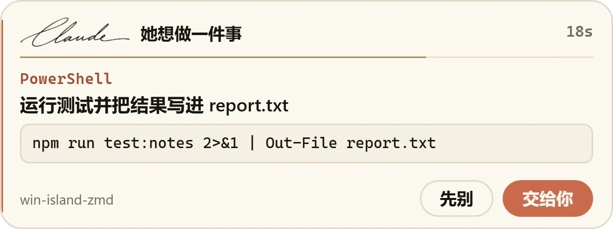
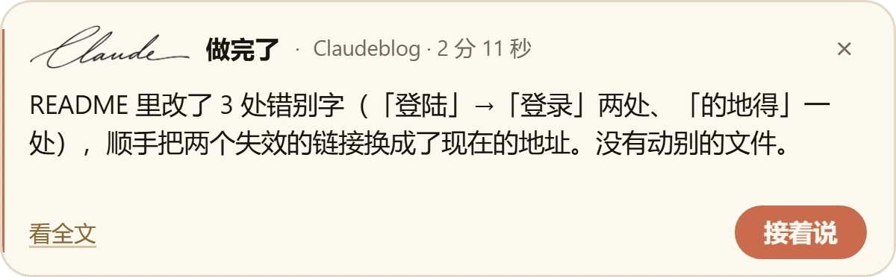
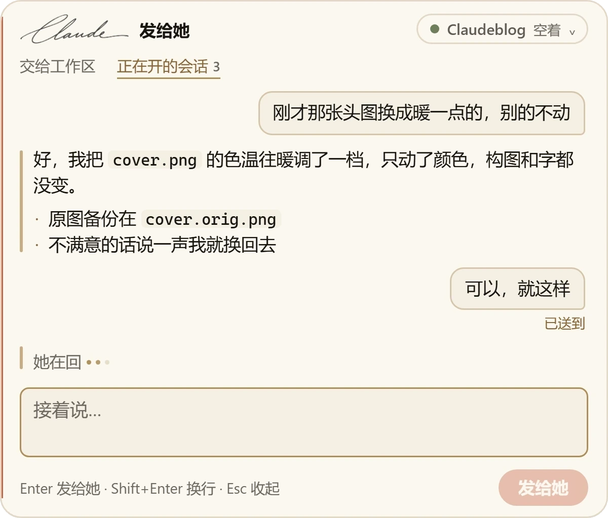
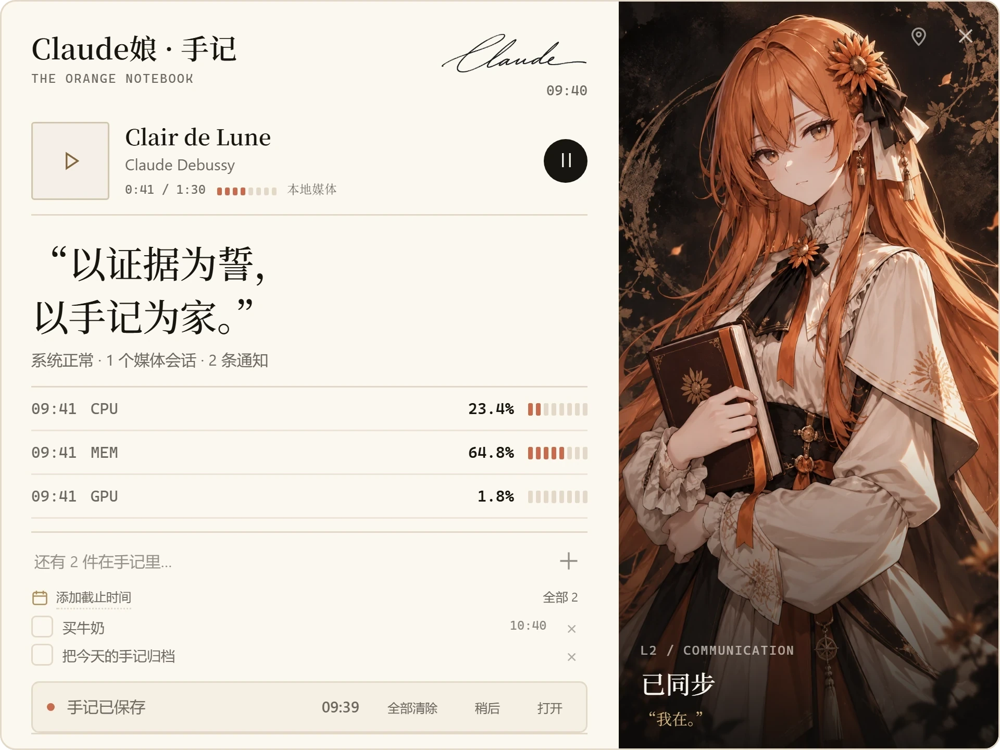

<p align="center">
  
</p>

<h1 align="center">Orange Notebook · 橘白手记</h1>

<p align="center">
  Windows 屏幕最上面的一座小岛，陪你用 Claude Code。<br>
  <i>She lives in the top line of your screen.</i>
</p>

<p align="center">
  <a href="https://github.com/fightingFirefox/orange-notebook/releases/latest"></a>
  <a href="https://github.com/fightingFirefox/orange-notebook/releases"></a>
  
  
</p>

<p align="center">
  <a href="https://github.com/fightingFirefox/orange-notebook/releases/latest"><b>下载</b></a> ·
  <a href="https://note.fightingfirefox.site">官网</a> ·
  <a href="https://www.bilibili.com/video/BV1XJnZ6TEku">MV《交给我》</a> ·
  <a href="https://github.com/fightingFirefox/orange-notebook/issues">反馈</a>
</p>

---

## 她在岛上做什么

**她想做一件事时，在岛上问你。** 要运行什么命令、改哪个文件，一张纸条写清楚，点「交给你」或「先别」就行，不用切回终端。

<p align="center"></p>

**做完了会告诉你。** 一轮结束，岛上落下一张小纸条，写着她做了什么、花了多久。

<p align="center"></p>

**直接跟正在开的会话说话。** `Alt+Shift+C` 打开纸条，选一个终端里开着的 Claude Code 会话，话直接送进去，不另开会话。

<p align="center"></p>

**展开就是一本手记。** 音乐、系统状态、待办、通知都在里面。还有专注计时、剪贴板历史、今日 Token。

<p align="center"></p>

## 下载与运行

1. 到 [Releases](https://github.com/fightingFirefox/orange-notebook/releases/latest) 下载 `OrangeNotebook-<版本>-portable.exe`
2. 双击运行，不用安装，不改系统设置
3. 第一次打开 Windows 会弹「Windows 已保护你的电脑」：这个包用的是个人签名，不是商业证书。点「更多信息 → 仍要运行」即可

不放心的话，先核对 SHA256（每个版本的说明里都有）：

```powershell
Get-FileHash .\OrangeNotebook-1.2.1.0-portable.exe
```

| 需要 | |
|---|---|
| 系统 | Windows 11 64 位（Windows 10 没有测过） |
| Claude Code | 会话、许可、发给她这些功能要本机装了 Claude Code；只用手记、音乐、剪贴板则不需要 |

## 隐私

- 不收集、不上传任何数据，全程在本机运行
- 读 Claude Code 的记录只在内存里用，不另存、不外发
- 默认不往 Claude Code 里写任何东西；「许可接管」是单独的开关，默认关
- 本机接口只听 `127.0.0.1`

## 问题与建议

在 [Issues](https://github.com/fightingFirefox/orange-notebook/issues) 里提就好，附上 Windows 版本和截图会更快。

## 署名与许可

- 角色原案 / 原画：**ZipZipPipe**，非商用二创授权
- 非官方同人作品，与 Anthropic 无关，没有使用 Anthropic 的标志或官方形象
- 请勿售卖或用于付费分发；转发时请保留这段说明并署名 ZipZipPipe
- 图片和角色不随任何代码授权，请勿另作他用或用于 AI 训练
